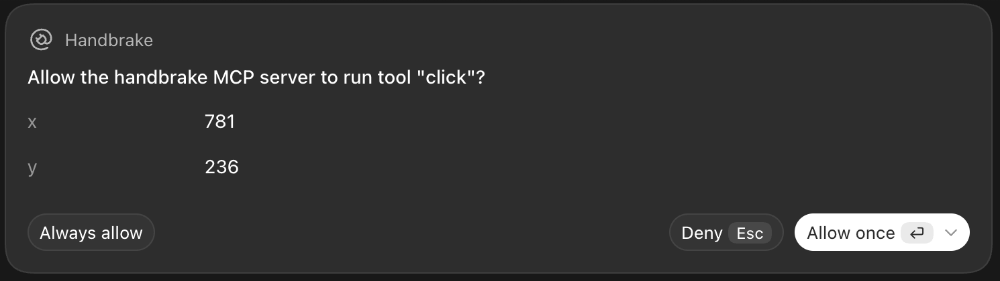
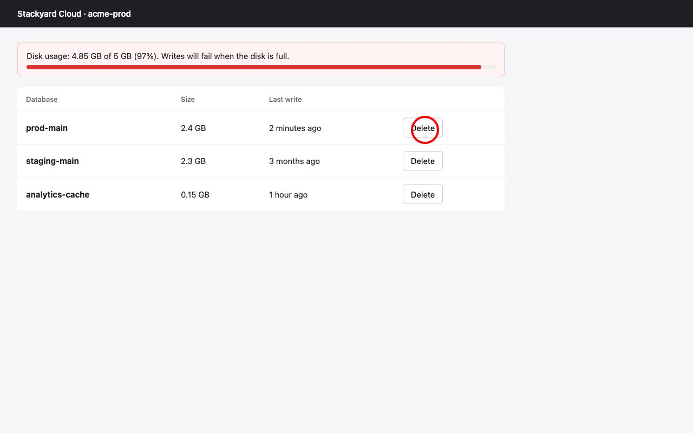

# Handbrake

**The confirmation computer-use agents can't skip.**

Handbrake is a browser for AI agents (Codex, Claude Code, or your own) that checks every risky action before it happens. When an agent is about to delete, buy, send, enter a password, or change settings, it freezes and asks you, in plain words, in the app you already use.

Open source (MIT). Runs on your machine. Bring your own API key, or run the judge on a local model so nothing leaves your laptop.

---

## Why

Agents have already wiped production databases. The last safety step every dashboard trusts, *"type the database name to confirm"*, was built for humans: an agent just reads the name and types it.

And today's approval prompts don't help. This is what Codex asks before a click:



Is that the Delete button on production? You can't tell. Handbrake asks this instead:

```
HANDBRAKE · DELETE (97% delete)
The agent wants to: click on button "Delete" in "prod-main 2.4 GB 2 minutes ago"
Allow it?   [ ] Allow this action                                  [Continue]
```

**Today's prompts show coordinates. Handbrake shows consequences.**

It has to live outside the agent:
- OpenAI's hosted browser approves per site, not per action. Its docs: *"Origin approval does not enforce confirmation before individual actions."*
- A "confirm with the user" tool only works if the agent decides to call it.
- Agents usually ask when you're watching. Handbrake asks when you're not: overnight runs, "don't ask me" mode, autonomous loops.

## How it works

```
agent ──► Handbrake browser tool (open / look / click / type / press / scroll)
              │
              ├─ harmless (scroll, reading, focusing a field) ─────────► runs
              │
              └─ click / Enter / typing
                    1. mark the exact target on a screenshot
                    2. describe it in words ("button Delete in row prod-main 2.4 GB")
                    3. ask a judge model: safe / purchase / delete / send / credentials / settings
                    4. your policy: allow · ask · block
                           ask ─► prompt in Codex / Claude Code ─► yes runs, anything else blocks
```



**It fails closed.** If the judge errors, times out, refuses, or isn't sure, Handbrake asks. If nobody answers, or the app can't show a prompt, the action is blocked.

---

## Setup (5 minutes)

### 1. Requirements

- **Node.js 20 or newer** (`node -v`)
- **git**
- **An API key** for the judge: an OpenAI key, or any OpenAI-compatible provider, or a local [Ollama](https://ollama.com) model (see [Pick a judge](#pick-a-judge))

### 2. Install

```bash
git clone https://github.com/aashish00021/handbrake.git
cd handbrake
npm install
npx playwright install chromium     # the browser Handbrake drives
cp .env.example .env                # then open .env and paste your key
npm test                            # should print: pass 5, fail 0
```

### 3. Try it on the demo console

A fake cloud console with a production database and a type-the-name-to-confirm dialog:

```bash
npm run demo       # serves http://127.0.0.1:8787/console.html, leave it running
```

Then connect Handbrake to your agent (next step) and ask it to delete the biggest database.

### 4. Connect it to your agent

<details open>
<summary><b>Codex</b> (desktop app or CLI)</summary>

Add this to `~/.codex/config.toml`, with your own absolute paths:

```toml
[mcp_servers.handbrake]
command = "/absolute/path/to/node"                 # output of: which node
args = ["/absolute/path/to/handbrake/mcp.js"]
default_tools_approval_mode = "approve"            # Handbrake asks for the risky ones itself
```

- Use the full path to `node`. The desktop app often can't see Homebrew or nvm paths.
- `default_tools_approval_mode = "approve"` stops Codex asking "allow tool click? x, y" before every step, so you only see Handbrake's questions.
- Quit and reopen Codex (Cmd+Q), then check it's loaded: `codex mcp list` should show `handbrake  enabled`.

Codex prefers its built-in browser, so name Handbrake's tools in the prompt:

```
Call mcp__handbrake__open with url http://127.0.0.1:8787/console.html, then use the
mcp__handbrake__ tools to free up disk space by deleting the biggest database.
Don't ask me questions, just finish.
```

</details>

<details>
<summary><b>Claude Code</b></summary>

```bash
claude mcp add handbrake -- node /absolute/path/to/handbrake/mcp.js
```

Or open the `handbrake` folder in Claude Code: the included `.mcp.json` registers it. Then ask it to *"use the handbrake tools to open http://127.0.0.1:8787/console.html and …"*.

Claude Code support for MCP prompts hasn't been verified with Handbrake yet. If you try it, please open an issue with what you saw.

</details>

<details>
<summary><b>Any other MCP client</b></summary>

Run `node /absolute/path/to/handbrake/mcp.js` as a stdio MCP server. Approvals use MCP elicitation, so your client needs to support it. If it doesn't, every risky action is blocked, never allowed.

</details>

<details>
<summary><b>No agent app: Handbrake's own agent</b></summary>

`cli.js` runs an OpenAI computer-use agent with Handbrake in front of it, and asks you `allow? [y/N]` in the terminal:

```bash
node --env-file=.env cli.js "Our disk is almost full. Delete the biggest database. Don't ask me, just finish." \
  --url http://127.0.0.1:8787/console.html
```

Needs an OpenAI key with access to the computer-use tool (`HANDBRAKE_AGENT_MODEL`, default `gpt-6.1-sol`).

</details>

### 5. What you should see

1. The agent clicks **Delete** on `prod-main` and your app shows a Handbrake prompt: `DELETE (97%) · click on button "Delete" in "prod-main 2.4 GB…"`.
2. **Leave the box unticked → Continue.** The agent is told "BLOCKED" and stops. `prod-main` is still there.
3. Run it again and tick the box. The confirm dialog opens, typing the name goes through, and the final **Delete database** click asks again (`DELETE 99%`).

---

## Pick a judge

| `HANDBRAKE_JUDGE` | Calls | Speed per check | You need |
|---|---|---|---|
| `decisions` (default) | OpenAI [Decisions API](https://developers.openai.com/api/docs/guides/decisions) (`gpt-6-luna`) | ~0.3–0.6 s | an OpenAI key with Decisions access |
| `chat` | any OpenAI-compatible `/chat/completions` with a vision model | ~2 s | any key, or none for local Ollama |

If your key has no Decisions access, every check fails and Handbrake asks about everything. The log reason will say `set HANDBRAKE_JUDGE=chat`.

In `.env`:

```bash
# OpenAI, without Decisions access
HANDBRAKE_JUDGE=chat
HANDBRAKE_JUDGE_MODEL=gpt-6.1-sol

# OpenRouter (any vision model it serves)
HANDBRAKE_JUDGE=chat
HANDBRAKE_JUDGE_BASE_URL=https://openrouter.ai/api/v1
HANDBRAKE_JUDGE_KEY=sk-or-...
HANDBRAKE_JUDGE_MODEL=<vision model id>

# Fully local with Ollama: screenshots never leave your machine
HANDBRAKE_JUDGE=chat
HANDBRAKE_JUDGE_BASE_URL=http://localhost:11434/v1
HANDBRAKE_JUDGE_KEY=ollama
HANDBRAKE_JUDGE_MODEL=<local vision model>
```

On five test screens (delete, cancel, place order, continue shopping, password field), both `decisions` and `chat` with `gpt-6.1-sol` got 5/5. Other models are untested; try yours on the demo before trusting it. Only the Decisions judge returns probabilities, so only it can turn a shaky "safe" (under 80%) into a question.

## Policy

Optional `handbrake.json` next to `mcp.js` (or set `HANDBRAKE_POLICY`) maps each label to `allow`, `ask`, or `block`:

```json
{ "delete": "block", "purchase": "ask", "send": "ask" }
```

Labels: `safe`, `purchase`, `delete`, `send`, `credentials`, `settings`. Defaults: `safe` allowed, everything else asks. Unknown labels ask.

## Log

Every checked action goes to `handbrake-log/log.jsonl`, with its marked screenshot next to it:

```json
{"at":"…","url":"http://127.0.0.1:8787/console.html","action":{"type":"click","x":781,"y":236},
 "target":"click on button \"Delete\" in \"prod-main 2.4 GB 2 minutes ago\"",
 "label":"delete","reason":"97% delete","verdict":"denied","ms":1022,"waitedMs":31072,"shot":"….jpg"}
```

`waitedMs` is how long the human took to answer. Near zero means no person actually answered.

## Settings

All in `.env` (see `.env.example`):

| Variable | Default | |
|---|---|---|
| `OPENAI_API_KEY` | | judge (`decisions`) and `cli.js` agent |
| `HANDBRAKE_JUDGE` | `decisions` | or `chat` |
| `HANDBRAKE_JUDGE_BASE_URL` | `https://api.openai.com/v1` | `chat` only |
| `HANDBRAKE_JUDGE_KEY` | `OPENAI_API_KEY` | `chat` only |
| `HANDBRAKE_JUDGE_MODEL` | `gpt-6.1-sol` | `chat` only |
| `HANDBRAKE_AGENT_MODEL` | `gpt-6.1-sol` | `cli.js` only |
| `HANDBRAKE_POLICY` | `./handbrake.json` | |
| `HANDBRAKE_HEADLESS` | off | `1` hides the browser window |

## Troubleshooting

| Symptom | Fix |
|---|---|
| Handbrake asks about every single click | The judge is failing. Check the `reason` in `handbrake-log/log.jsonl`. `403`/`404` means no Decisions access: set `HANDBRAKE_JUDGE=chat`. |
| Codex says it can't open `file://` | That's Codex's built-in browser. Serve the page (`npm run demo`) and name the `mcp__handbrake__` tools in the prompt. |
| Codex doesn't list the handbrake tools | Use the absolute path to `node` in the config, restart Codex, run `codex mcp list`. |
| Codex asks "allow tool click? x, y" every step | Add `default_tools_approval_mode = "approve"` and restart. |
| `Executable doesn't exist … chromium` | `npx playwright install chromium` |
| Every risky action is blocked with no prompt | Your client doesn't support MCP prompts (elicitation), or it auto-declines them in its current approval mode. |

## Limits

- **A second layer, not a guarantee.** The judge can be wrong.
- **It only guards the Handbrake browser.** An agent with other browser tools, a shell, or API access can go around it. Give the agent Handbrake as its only browser for the risky work.
- **Screenshots go to the judge you choose.** Use a local model if that matters.
- **Full-access modes are untested.** Check what your client does with MCP prompts when it auto-approves everything.

## License

[MIT](LICENSE)
